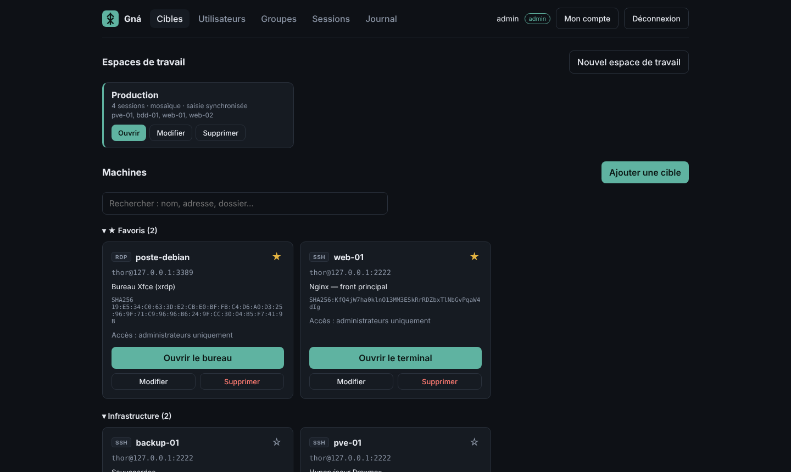
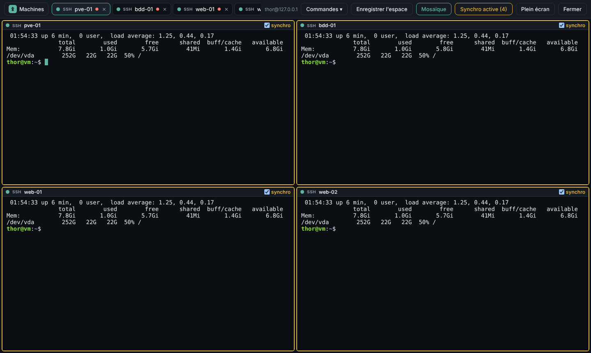
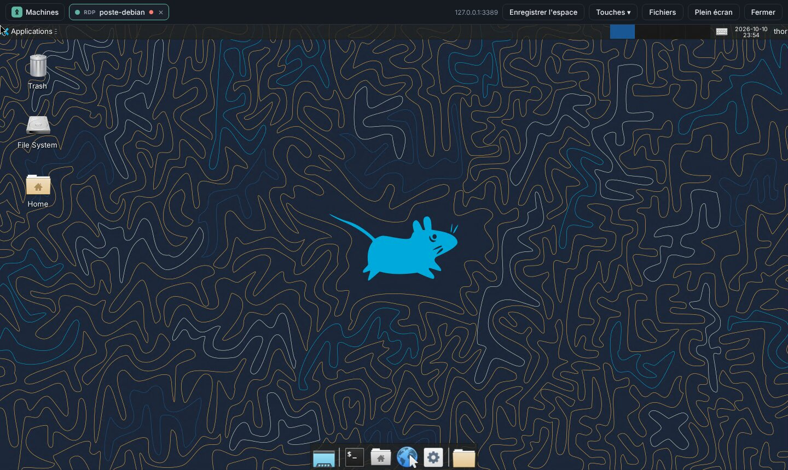
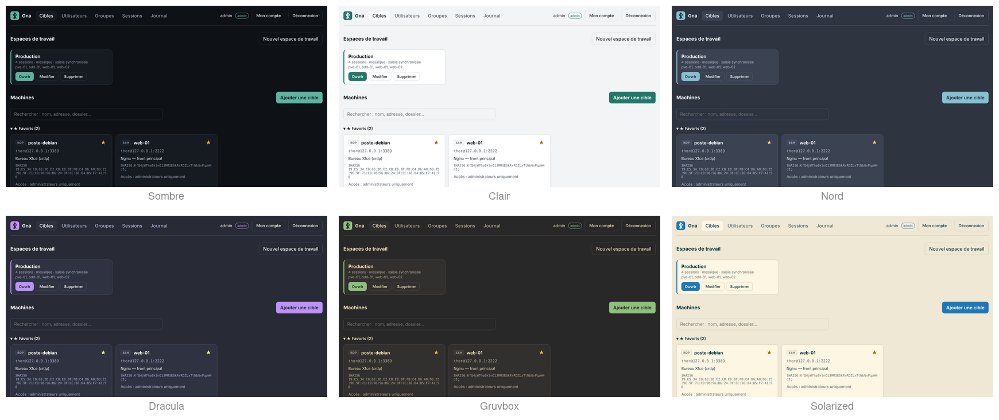

<p align="center">
  <picture>
    <source media="(prefers-color-scheme: dark)" srcset="docs/images/logo-sombre.png">
    
  </picture>
</p>

<p align="center">
  <b>Bastion d'accès SSH, VNC et RDP</b>, depuis le navigateur ou l'application Windows, Linux et Android.<br>
  Installation native (paquet .deb + systemd), sans Docker.
</p>

<p align="center">
  
  
  
  
  
</p>

> Dans la mythologie nordique, Gná est la messagère de Frigg : elle voyage d'un monde à l'autre sur Hófvarpnir.



## Télécharger

Les fichiers d'installation de chaque version sont dans les [**Releases**](../../releases/latest) :

| Fichier | Pour |
|---|---|
| `gna-server_<version>_amd64.deb` | le **serveur** (Debian 12+, Ubuntu 22.04+) |
| `gna-app_<version>_amd64.deb` / `Gna-<version>-x86_64.AppImage` | l'application **Linux** |
| `Gna-<version>-windows-setup.exe` | l'application **Windows** 10/11 |
| `Gna-<version>-android.apk` | l'application **Android** 7+ |

## Fonctionnalités

| | |
|---|---|
| **Accès** | Terminal SSH, bureaux VNC et RDP (Windows, xrdp) dans le navigateur ; fichiers SSH (SFTP) et transferts vers les bureaux RDP |
| **Sécurité** | Mot de passe + MFA (TOTP), droits par utilisateur et par groupe, empreintes des machines vérifiées, secrets chiffrés, journal d'audit |
| **Sessions** | Plusieurs sessions en onglets ou en **mosaïque**, saisie synchronisée sur plusieurs terminaux, enregistrement et relecture |
| **Confort** | Copier-coller direct, redimensionnement automatique, touches spéciales, bibliothèque de commandes, espaces de travail, favoris, dossiers, 7 thèmes |
| **Application** | Windows, Linux et Android (Tauri), certificat du serveur épinglé |
| **Installation** | Paquet .deb (PostgreSQL, service systemd, configuration créés automatiquement) |

<table>
  <tr>
    <td width="50%"><p align="center"><sub>Mosaïque et saisie synchronisée</sub></p></td>
    <td width="50%"><p align="center"><sub>Bureau RDP dans le navigateur</sub></p></td>
  </tr>
</table>



## État : étape 13 — thèmes et application Linux à jour

- **Thèmes** : « Mon compte » → Thème : Système (suit le réglage clair/sombre de l'ordinateur), Sombre, Clair, Nord, Dracula, Gruvbox, Solarized. Le thème s'applique tout de suite, terminaux et bureaux à distance compris (couleurs ANSI adaptées à chaque thème), et il est **enregistré dans le compte** : il suit l'utilisateur d'un navigateur ou d'un appareil à l'autre
- **Application Linux** (paquet `gna-app`, pour ne plus se confondre avec le paquet serveur `gna`) : téléchargements SFTP et RDP enregistrés dans le dossier Téléchargements (sans écraser un fichier existant, message de confirmation), relais local sur un port stable (les réglages de la page sont conservés d'un lancement à l'autre)

## Étape 12 — organisation, bibliothèque de commandes, espaces de travail

- **Organisation des machines par dossier** : dans le formulaire d'une cible, le dossier se choisit dans une **liste déroulante** des dossiers existants, ou « Nouveau dossier… ». La liste des machines est groupée par dossier (groupes repliables, état mémorisé), avec une **recherche** (nom, adresse, dossier, description). Les anciennes étiquettes ont été fusionnées dans les dossiers (une machine sans dossier a pris sa première étiquette)
- **Favoris** : l'étoile d'une carte place la machine dans le groupe « ★ Favoris », en tête de liste (favoris propres à chaque utilisateur)
- **Bibliothèque de commandes** : menu « Commandes » d'un terminal SSH. Une commande enregistrée part d'un clic dans le terminal actif, ou dans **tous les terminaux synchronisés** si la saisie synchronisée est active (le menu l'indique). Option « exécuter directement » (Entrée) ; les commandes sur plusieurs lignes sont validées ligne par ligne. Gestion (ajout, modification, suppression) depuis ce menu ; bibliothèque propre à chaque utilisateur
- **Espaces de travail** : un ensemble de machines rouvert d'un clic, avec sa disposition (onglets ou mosaïque) et la saisie synchronisée. Création et modification **sans ouvrir de connexion** (« Nouvel espace de travail », « Modifier » : nom, machines, disposition, synchro), ou enregistrement des sessions ouvertes (« Enregistrer l'espace » dans l'écran des sessions)

## Étape 11 — mosaïque et saisie synchronisée

- **Mosaïque** (bouton dans la barre des sessions, dès 2 sessions) : toutes les sessions ouvertes sont visibles en même temps, en grille (2, 4, 9… volets). Un clic sur un volet en fait la session active (barre d'outils, panneaux). Les bureaux VNC/RDP y sont mis à l'échelle sans changer leur résolution ; ils la retrouvent en revenant aux onglets. Le choix est mémorisé dans le navigateur. En mosaïque, les boutons « Fichiers » (SFTP et RDP) et le glisser-déposer sont désactivés, pour ne jamais envoyer un fichier vers la mauvaise machine
- **Saisie synchronisée** (dès 2 terminaux SSH) : ce qui est tapé (ou collé) dans un terminal part dans tous les terminaux cochés « synchro » — pratique pour une même commande sur plusieurs serveurs. Les terminaux concernés ont une bordure orange et le bouton affiche « Synchro active (n) ». Chaque session reste enregistrée et journalisée séparément

## Étape 10 — plusieurs sessions en onglets

- Plusieurs sessions **SSH, VNC et RDP ouvertes en même temps**, chacune dans son onglet ; la même machine peut être ouverte plusieurs fois (« serveur 2 »)
- Les onglets en arrière-plan **restent connectés** (le terminal continue de recevoir, le bureau garde sa taille) ; passer d'un onglet à l'autre est instantané
- Bouton **« Machines »** pour revenir à la liste et ouvrir une autre session sans fermer les autres ; depuis la liste, **« Sessions ouvertes »** (avec leur nombre) ramène aux onglets
- Barre d'outils et panneaux (Fichiers SFTP ou RDP, touches) propres à l'onglet actif ; chaque onglet garde son panneau ouvert et son dossier SFTP
- Point de couleur par onglet (connexion, connecté, déconnecté) et ● rouge si la session est enregistrée ; « ✕ » ferme un onglet, la déconnexion de Gná ferme tout

## Étape 9 — paquet Debian, fichiers SSH (SFTP), logo

- **Paquet .deb du serveur** : `make deb` produit `dist/gna_<version>_amd64.deb`. Installation et mises à jour avec `sudo apt install ./gna_<version>_amd64.deb` (voir « Installation »). Une installation faite avec `install.sh` est reprise automatiquement : configuration, clé maître, base et enregistrements sont conservés
- **Fichiers en SSH (SFTP)** : bouton « Fichiers » du terminal. Parcourir les dossiers de la cible, envoyer (bouton ou glisser-déposer sur le terminal), télécharger, créer un dossier. Tout passe par la connexion SSH du terminal, avec les droits du compte de la cible ; rien n'est stocké sur le serveur Gná. Journalisé (`file.upload`, `file.download`, `file.mkdir`). Désactivé avec `GNA_FILE_TRANSFER=false`
- **Logo** : rune liée de Gná (interface web, favicon, icônes de l'application) ; fichiers sources dans `deploy/logo/`
- `gna version` affiche la version installée

## Étape 8 — outils des bureaux à distance

Barre d'outils des sessions RDP et VNC :

- **Copier-coller direct**, dans les deux sens et en UTF-8 (accents, €, emoji…) : ce qui est copié sur la machine distante arrive dans le presse-papiers du poste, et Ctrl+V (ou Maj+Inser) sur le bureau distant colle le presse-papiers du poste. Le collage utilise le collage natif du navigateur : aucune autorisation à donner, quel que soit le navigateur. RDP : canal presse-papiers standard (Windows, xrdp), la touche Ctrl+V est retenue jusqu'à ce que le texte soit arrivé ; VNC : selon le serveur VNC
- **Redimensionnement automatique** : le bureau distant prend la taille de la fenêtre, sans reconnexion (RDP : Windows 8.1 et plus récent, xrdp 0.10 ; VNC : TigerVNC et la plupart des serveurs récents). Sinon, l'image est mise à l'échelle
- **Transfert de fichiers** (RDP) : lecteur partagé « Gna » sur la machine distante (Windows : *Ce PC → Gna sur GNA* ; xrdp : `~/thinclient_drives/Gna`). Depuis le panneau « Fichiers » : envoi (bouton ou glisser-déposer sur le bureau) et téléchargement de ce que la machine distante y dépose. Un dossier par session, supprimé à la fin, taille plafonnée (`GNA_TRANSFER_MAX_MB`). Envois et téléchargements sont journalisés (`file.upload`, `file.download`)
- **Touches** : Ctrl+Alt+Suppr, touche Windows, Alt+Tab, Ctrl+Échap, Windows+L, Impr. écran
- Plein écran, reconnexion

Sécurité : la machine distante est traitée comme non fiable. Le lecteur partagé n'expose que le dossier de la session (chemins `..`, liens symboliques et flux NTFS refusés), les fichiers téléchargés sont servis en pièce jointe. `GNA_CLIPBOARD=false` et `GNA_FILE_TRANSFER=false` désactivent ces outils pour tous (en VNC, le presse-papiers est alors retiré des messages du navigateur).

**Prérequis xrdp** : le paquet Debian gère le lecteur partagé (FUSE) ; l'utilisateur doit pouvoir utiliser FUSE (c'est le cas par défaut).

## Étape 7 — bureau à distance RDP (Windows et xrdp)

Les cibles **RDP** s'ouvrent dans le navigateur comme les cibles VNC, avec les mêmes garanties :

- **Identifiants côté serveur** : Gná lance la passerelle `gna-rdp` (Rust, fondée sur [IronRDP](https://github.com/Devolutions/IronRDP), licence MIT/Apache-2.0) et lui transmet les identifiants par un tube ; le navigateur ne les voit jamais
- **Authentification NLA** (comme Windows l'exige par défaut), ou TLS seul (xrdp)
- **Certificat RDP épinglé** : son empreinte est relevée à l'ajout de la cible (« Récupérer l'empreinte ») ; un autre certificat bloque la connexion
- La passerelle convertit l'écran RDP en flux VNC : affichage noVNC, **enregistrement et relecture** identiques aux sessions VNC, droits d'accès, audit (`rdp.session_start`, `rdp.cert_mismatch`…)
- **Clavier** : chaque caractère est converti en touche physique selon la disposition choisie pour la cible (Français Windows, Français Linux/xrdp, Anglais US), touches mortes comprises (ê, ë, ñ…) ; Unicode en dernier recours
- Compatible xrdp 0.10 (Debian 13) : compression d'xrdp désactivée (mal décodée par IronRDP) et message de réactivation abrégé d'xrdp pris en charge

**Préparer une cible Windows** : activer le Bureau à distance (Paramètres → Système → Bureau à distance), autoriser le compte, ouvrir le port 3389 au seul serveur Gná. Pour comparer l'empreinte du certificat (PowerShell administrateur) :

```powershell
$c=(Get-ChildItem 'Cert:\LocalMachine\Remote Desktop')[0]
[BitConverter]::ToString([Security.Cryptography.SHA256]::Create().ComputeHash($c.RawData)) -replace '-',':'
```

**Cible Linux avec xrdp** : `sudo apt install xrdp`, puis `openssl x509 -in /etc/xrdp/cert.pem -noout -fingerprint -sha256` pour l'empreinte ; choisir le clavier « Français (Linux / xrdp) ».

Limite : pas de son.

**Installation** : `make build` compile la passerelle si Rust ≥ 1.89 est installé (rustup), sinon utilise le binaire précompilé fourni (`deploy/prebuilt/`, Linux x86-64, Debian 13 / Ubuntu 24.04). `install.sh` l'installe dans `/usr/local/bin/gna-rdp`.

## Étape 6 — application Windows, Linux et Android

Application de bureau et mobile (Tauri 2) dans `app/` : l'interface de Gná dans sa propre fenêtre, avec le certificat du serveur **épinglé** (empreinte validée au premier lancement, connexion bloquée s'il change). Voir [app/README.md](app/README.md).

## Étape 5 — enregistrement des sessions SSH et VNC

- **Chaque session SSH est enregistrée** (tout ce qui s'affiche, horodaté, au format asciicast d'asciinema) ; l'utilisateur voit un indicateur **REC** dans son terminal
- **Fichiers chiffrés** sur le disque avec la clé maître (AES-256-GCM par blocs) : un bloc modifié, déplacé ou supprimé est détecté, et une session interrompue brutalement reste lisible jusqu'aux dernières secondes
- **Relecture** dans l'onglet Sessions (admins) : lecture, pause, vitesse, déplacement dans le temps, export `.cast`
- **Recherche** d'un texte affiché dans toutes les sessions récentes ou dans une seule ; un clic sur un résultat saute au moment correspondant
- Si l'enregistrement est activé mais impossible (disque plein…), **la connexion est refusée** plutôt que d'ouvrir un accès non tracé
- Frappes clavier non enregistrées par défaut (elles contiendraient les mots de passe tapés, ex. `sudo`) ; activables avec `GNA_RECORD_INPUT=true`
- Conservation 90 jours par défaut, puis suppression automatique (tracée dans le journal)
- Chaque relecture et chaque recherche est tracée dans le journal d'audit

**Sessions VNC** : le flux d'écran est enregistré de la même façon (chiffré, refus si impossible, indicateur REC). À la relecture, il est réinjecté dans noVNC, donc l'affichage est identique à la session en direct : lecture, pause, vitesse ×1 à ×16, déplacement dans le temps, et option « Sauter les inactivités » qui raccourcit les moments où l'écran ne bouge pas. Pas de recherche de texte pour le VNC (ce sont des images). Taille indicative : de quelques Mo à quelques dizaines de Mo par heure selon l'activité à l'écran ; désactivable avec `GNA_RECORD_VNC=false`.

## Étape 4 — droits d'accès

- **Utilisateurs gérés depuis l'interface** (onglet Utilisateurs) : création avec mot de passe initial, droits admin, désactivation, déverrouillage, nouveau mot de passe, réinitialisation de la MFA, suppression
- **Groupes** d'utilisateurs
- **Accès aux cibles** accordé par groupe ou par utilisateur (section « Accès » de chaque cible). Les administrateurs ont accès à tout ; un utilisateur ne voit que ses cibles, et une cible non attribuée répond « introuvable »
- **Retrait immédiat** : un terminal ou un bureau ouvert se ferme dans les 30 secondes si l'accès est retiré ou le compte désactivé
- **Mon compte** : chacun change son mot de passe (les sessions sur ses autres appareils sont fermées)
- Garde-fous : un admin ne peut ni se rétrograder, ni se désactiver, ni se supprimer, et il reste toujours au moins un admin actif
- Tout est tracé dans le journal (créations, modifications d'accès, accès refusés…)

## Étape 3 — bureau à distance VNC

- Cibles **VNC** : bureau complet dans le navigateur (noVNC), adapté à la taille de la fenêtre, plein écran, Ctrl+Alt+Suppr
- **Le mot de passe VNC ne quitte jamais le serveur** : Gná s'authentifie lui-même auprès de la cible, puis présente au navigateur une connexion déjà authentifiée
- Mêmes garanties que le SSH : sessions tracées, audit, fermeture si la session Gná expire ou est révoquée
- Message clair si la cible refuse (mauvais mot de passe, méthode de sécurité non gérée…)

## Étape 2 — terminal SSH dans le navigateur

- Cibles SSH gérées par les administrateurs : adresse, identifiant, **mot de passe ou clé privée chiffrés en base** (jamais renvoyés au navigateur)
- **Clé d'hôte épinglée** : l'empreinte est récupérée et vérifiée à l'ajout ; toute clé différente ensuite bloque la connexion (protection contre l'interception)
- Terminal complet dans le navigateur (xterm.js) : couleurs, redimensionnement, copier-coller
- Le navigateur ne parle jamais à la cible : Gná ouvre la connexion SSH et relaie le flux via WebSocket
- Un terminal ouvert se ferme si la session Gná expire, est déconnectée ou si le compte est désactivé
- Historique des sessions d'accès (qui, quelle cible, durée, volume, motif de fin) et événements dans le journal d'audit

## Étape 1 — authentification

- Connexion par identifiant + mot de passe (hash **Argon2id**)
- **TOTP obligatoire** : enrôlement par QR code au premier login, protection contre le rejeu des codes
- Sessions côté serveur : seul le hash du jeton est stocké, jeton renouvelé après la MFA, expiration absolue (12 h) et après inactivité (30 min)
- Verrouillage du compte après 5 échecs (15 min), limitation de débit par IP sur les routes d'authentification
- Secrets TOTP **chiffrés** en base (AES-256-GCM avec une clé maître)
- **Journal d'audit** en ajout seul (un trigger PostgreSQL interdit modification et suppression)
- Protections web : cookie `HttpOnly` + `SameSite=Strict` (+ préfixe `__Host-` en HTTPS), CSP stricte, contrôle de l'origine, corps JSON obligatoire
- Interface web minimale embarquée dans le binaire

## Installation (Debian / Ubuntu)

Gná tourne en natif : un binaire statique, un service systemd durci, un utilisateur système dédié et PostgreSQL local. Aucun conteneur.

### Avec le paquet .deb (recommandé)

```bash
sudo apt install ./gna_0.13.0_amd64.deb      # installe aussi PostgreSQL si besoin
sudo -u gna gna user add admin --admin
```

Le paquet crée l'utilisateur `gna`, la base, `/etc/gna/gna.env` (avec une clé maître neuve, une seule fois) et le service, puis le démarre. **Mise à jour** : la même commande `apt install` avec le nouveau fichier ; la configuration et les données sont conservées et le service redémarré. Désinstallation : `sudo apt remove gna` (les données restent ; `purge` indique comment tout effacer).

Construire le paquet (Go 1.23+, `make`, `dpkg-deb`) : `make deb`.

### Depuis les sources

```bash
make build                 # récupère les dépendances et compile bin/gna
sudo ./deploy/install.sh   # installe PostgreSQL si besoin, crée l'utilisateur gna, la base, la config et le service
sudo -u gna gna user add admin --admin
```

Puis ouvrir **https://<ip-du-serveur>:8443**, accepter l'avertissement du certificat auto-signé (après avoir comparé son empreinte avec `sudo -u gna gna tls info`), se connecter et scanner le QR code avec une application TOTP (Aegis, 2FAS, Bitwarden, Google Authenticator…).

Ce qui est installé (`install.sh` est relançable sans risque, il ne touche pas à une config ou une base existante) :

| Élément | Emplacement |
|---|---|
| Binaires | `/usr/bin/gna` et `/usr/bin/gna-rdp` (paquet) ou `/usr/local/bin/` (`install.sh`) |
| Configuration (contient la clé maître) | `/etc/gna/gna.env`, droits `root:gna 640` |
| Service | `gna.service` (utilisateur `gna`, sans privilèges, système en lecture seule) |
| Certificat HTTPS auto-signé | `/var/lib/gna/tls/`, créé au premier démarrage |
| Base | PostgreSQL local, base `gna`, connexion par socket Unix sans mot de passe (authentification *peer*) |

Commandes utiles :

```bash
systemctl status gna
journalctl -u gna -f
sudo systemctl restart gna      # après une modification de /etc/gna/gna.env
```

Mise à jour depuis les sources : `make build && sudo ./deploy/install.sh`, ou `make deb` puis `sudo apt install ./dist/gna_<version>_amd64.deb`.

### Accès réseau et HTTPS

Par défaut, Gná écoute sur toutes les interfaces (`0.0.0.0:8443`) **en HTTPS uniquement**, avec un certificat auto-signé couvrant le nom de la machine et ses adresses IP. Gná refuse d'écouter en HTTP en clair ailleurs que sur `127.0.0.1` : mots de passe et codes TOTP circuleraient en clair sur le réseau.

- Changement d'adresse IP du serveur : `sudo -u gna gna tls regen && sudo systemctl restart gna`
- Vrai certificat (Let's Encrypt, PKI interne) : `GNA_TLS_SELF_SIGNED=false` et renseigner `GNA_TLS_CERT` / `GNA_TLS_KEY` (fichiers lisibles par l'utilisateur `gna`)
- Accès limité à la machine elle-même : `GNA_LISTEN=127.0.0.1:8443`

### Fichier de configuration

Gná lit automatiquement `/etc/gna/gna.env` (ou le fichier indiqué par `GNA_CONFIG`). Les variables d'environnement ont priorité sur le fichier. Gná refuse de démarrer si ce fichier est lisible par tous les utilisateurs.

Les commandes d'administration se lancent sous l'utilisateur `gna` pour lire la configuration : `sudo -u gna gna user list`.

## Commandes

| Commande | Rôle |
|---|---|
| `gna serve` | Démarre le serveur (applique les migrations automatiquement) |
| `gna migrate` | Applique les migrations seules |
| `gna keygen` | Génère une clé maître |
| `gna tls info` | Empreinte, noms couverts et expiration du certificat |
| `gna tls regen` | Régénère le certificat auto-signé |
| `gna user add <nom> [--admin]` | Crée un utilisateur |
| `gna user list` | Liste les utilisateurs (admin, MFA, état) |
| `gna user passwd <nom>` | Change le mot de passe et ferme ses sessions |
| `gna user reset-mfa <nom>` | Réinitialise la MFA (téléphone perdu) |
| `gna user disable` / `enable <nom>` | Désactive ou réactive un compte |
| `gna user unlock <nom>` | Lève un verrouillage |

Le mot de passe est demandé sans écho, ou lu sur l'entrée standard : `echo "…" | sudo -u gna gna user add bob`.

## Configuration

| Variable | Défaut | Rôle |
|---|---|---|
| `GNA_DATABASE_URL` | *obligatoire* | URL PostgreSQL |
| `GNA_MASTER_KEY` | *obligatoire* | Clé de chiffrement, 32 octets en base64 |
| `GNA_LISTEN` | `:8080` | Adresse d'écoute (`0.0.0.0:8443` dans la config installée) |
| `GNA_TLS_SELF_SIGNED` | `false` | HTTPS avec certificat auto-signé généré (`true` dans la config installée) |
| `GNA_TLS_CERT` / `GNA_TLS_KEY` | — | HTTPS avec un certificat fourni (PEM) |
| `GNA_DATA_DIR` | `/var/lib/gna` | Données locales (certificat) |
| `GNA_ALLOW_PLAIN_HTTP` | `false` | Autoriser le HTTP en clair hors localhost (déconseillé) |
| `GNA_COOKIE_SECURE` | `true` | Cookie réservé au HTTPS (forcé à `true` quand Gná sert du HTTPS) |
| `GNA_TRUST_PROXY` | `false` | Lire l'IP client dans `X-Forwarded-For` (derrière un reverse proxy) |
| `GNA_SESSION_TTL` | `12h` | Durée maximale d'une session |
| `GNA_IDLE_TIMEOUT` | `30m` | Déconnexion après inactivité |
| `GNA_MAX_FAILURES` | `5` | Échecs avant verrouillage |
| `GNA_LOCK_DURATION` | `15m` | Durée du verrouillage |
| `GNA_ISSUER` | `Gná` | Nom affiché dans l'application TOTP |
| `GNA_RECORD_SESSIONS` | `true` | Enregistrer les sessions SSH |
| `GNA_RECORD_VNC` | = `GNA_RECORD_SESSIONS` | Enregistrer les sessions VNC et RDP |
| `GNA_RDP_BRIDGE` | à côté de `gna`, puis `/usr/local/bin/gna-rdp` | Chemin de la passerelle RDP |
| `GNA_CLIPBOARD` | `true` | Copier-coller dans les bureaux à distance |
| `GNA_FILE_TRANSFER` | `true` | Transfert de fichiers RDP (lecteur partagé « Gna ») |
| `GNA_TRANSFER_MAX_MB` | `1024` | Taille maximale du dossier de transfert d'une session |
| `GNA_RECORD_INPUT` | `false` | Enregistrer aussi les frappes clavier |
| `GNA_RECORDING_RETENTION_DAYS` | `90` | Durée de conservation des enregistrements (0 = illimitée) |

## API

| Méthode | Route | Étape requise |
|---|---|---|
| `POST` | `/api/auth/login` | aucune |
| `POST` | `/api/auth/totp/enroll` | `enroll` |
| `POST` | `/api/auth/totp/enroll/confirm` | `enroll` |
| `POST` | `/api/auth/totp/verify` | `mfa` |
| `POST` | `/api/auth/logout` | toute session |
| `GET` | `/api/me` | toute session |
| `GET` | `/api/admin/audit?limit=100` | `full` + admin |
| `GET` | `/api/targets` | `full` |
| `GET` (WebSocket) | `/api/targets/{id}/ssh?cols=&rows=` | `full` |
| `GET` (WebSocket) | `/api/targets/{id}/vnc` | `full` |
| `POST` | `/api/admin/targets` | `full` + admin |
| `PUT` / `DELETE` | `/api/admin/targets/{id}` | `full` + admin |
| `POST` | `/api/admin/targets/scan` | `full` + admin |
| `GET` | `/api/admin/access-sessions` | `full` + admin |
| `GET` / `POST` | `/api/admin/users` | `full` + admin |
| `POST` | `/api/admin/users/{id}/{promote,demote,disable,enable,unlock,reset-mfa,password,delete}` | `full` + admin |
| `GET` / `POST` | `/api/admin/groups` | `full` + admin |
| `PUT` / `DELETE` | `/api/admin/groups/{id}` | `full` + admin |
| `POST` | `/api/me/password` | `full` |
| `GET` | `/api/admin/recordings/{session}/cast` | `full` + admin |
| `GET` | `/api/admin/recordings/{session}/vnc` | `full` + admin |
| `GET` | `/api/admin/recordings/{session}/search?q=` | `full` + admin |
| `GET` | `/api/admin/recordings/search?q=&days=` | `full` + admin |

## En production

- Toujours en **HTTPS** : certificat auto-signé intégré, vrai certificat, ou reverse proxy local (Gná sur `127.0.0.1` + `GNA_TRUST_PROXY=true`).
- N'ouvrir le port 8443 qu'aux réseaux qui en ont besoin (pare-feu).
- Sauvegarder **la base, `/var/lib/gna/recordings` et la clé maître séparément**. Sans la clé, les secrets et les enregistrements chiffrés sont perdus.
- Ne pas exposer PostgreSQL : il n'écoute que sur la machine par défaut.

## Structure

```
cmd/gna/            point d'entrée et commandes CLI
internal/config/    lecture des variables d'environnement
internal/secure/    Argon2id, chiffrement AES-GCM
internal/totp/      TOTP (RFC 6238)
internal/store/     PostgreSQL et migrations SQL
internal/auth/      logique de connexion et de sessions
internal/api/       routes HTTP, middlewares, limitation de débit
internal/tlsutil/   HTTPS : certificat auto-signé, configuration TLS
internal/sshproxy/  connexions SSH sortantes, clé d'hôte épinglée
internal/vncproxy/  relais VNC (RFB), authentification côté serveur
internal/recording/ enregistrements chiffrés (asciicast) et recherche
internal/web/       interface web embarquée
deploy/             service systemd, modèle de configuration, script d'installation
app/                application Windows, Linux, Android (Tauri + relais Rust)
rdpbridge/          passerelle RDP → VNC (Rust, IronRDP) : écran, clavier, presse-papiers, lecteur partagé
rdpbridge/vendor/   ironrdp-rdpdr avec un correctif (nom du lecteur vu par xrdp)
internal/transfer/  dossiers de transfert de fichiers des sessions RDP
internal/api/sftp.go  transfert de fichiers des sessions SSH (SFTP)
deploy/deb/         paquet Debian du serveur (make deb)
deploy/logo/        logo et icônes (rune liée)
internal/rdp/       pilotage de la passerelle RDP
```

## Ajouter une cible SSH

1. Onglet **Cibles** → **Ajouter une cible** (compte admin).
2. Renseigner l'adresse, le port et l'identifiant, puis le mot de passe ou la clé privée.
3. **Récupérer l'empreinte**, et la comparer avec celle affichée sur la cible : `ssh-keygen -lf /etc/ssh/ssh_host_ed25519_key.pub`.
4. Enregistrer, puis **Ouvrir le terminal**.

Si la clé d'hôte d'une cible change légitimement (réinstallation), la modifier et récupérer à nouveau l'empreinte.

## Ajouter une cible VNC

Sur la machine cible (exemple Debian + XFCE, avec TigerVNC) :

```bash
sudo apt install tigervnc-standalone-server dbus-x11
vncpasswd                      # 8 caractères max ; « n » pour le mot de passe view-only
printf '#!/bin/sh\nunset SESSION_MANAGER\nunset DBUS_SESSION_BUS_ADDRESS\nexec dbus-launch --exit-with-session startxfce4\n' > ~/.config/tigervnc/xstartup
chmod +x ~/.config/tigervnc/xstartup
tigervncserver -xstartup ~/.config/tigervnc/xstartup -localhost no :1   # port 5901
```

Dans Gná : **Ajouter une cible** → protocole **VNC**, adresse, port (5901 pour l'écran `:1`), mot de passe VNC.

Le flux VNC entre Gná et la cible n'est pas chiffré par le protocole : limiter le port VNC de la cible à l'IP de Gná (pare-feu), ou le garder sur un réseau de confiance.

## Choix techniques

`guacd` (Apache Guacamole) a été retiré des dépôts de Debian 13. Pour rester en natif sans rien compiler en C, le SSH est géré directement par Gná avec la bibliothèque SSH officielle de Go (`golang.org/x/crypto/ssh`) et le terminal xterm.js côté navigateur. Pour le VNC, Gná relaie lui-même le protocole RFB et le navigateur l'affiche avec noVNC. Les fichiers de xterm.js (licence MIT), noVNC (licence MPL-2.0) et asciinema-player (licence Apache 2.0) sont embarqués dans le binaire : aucune ressource externe n'est chargée.

## Feuille de route

1. ~~Authentification + MFA~~
2. ~~Terminal SSH dans le navigateur~~
3. ~~VNC et RDP~~
4. ~~Droits d'accès par utilisateur et par groupe~~
5. ~~Enregistrement et relecture des sessions SSH et VNC~~
6. ~~Application Windows, Linux et Android (Tauri)~~
7. ~~RDP (passerelle IronRDP)~~
8. ~~Outils des bureaux à distance : copier-coller, redimensionnement, fichiers, touches~~
9. ~~Paquet Debian, fichiers SSH (SFTP), logo~~
10. ~~Plusieurs sessions en onglets~~
11. ~~Mosaïque et saisie synchronisée (SSH)~~
12. ~~Organisation des machines (dossiers), bibliothèque de commandes, espaces de travail~~
13. ~~Thèmes, mise à jour de l'application Linux~~

## Licence

Logiciel propriétaire, **gratuit** : chacun peut le télécharger, l'installer et l'utiliser, à titre personnel ou professionnel. Le modifier, le redistribuer ou le vendre reste interdit sans l'accord de l'auteur (voir `LICENSE`). Les composants tiers inclus gardent leur propre licence (voir `THIRD-PARTY.md`).
